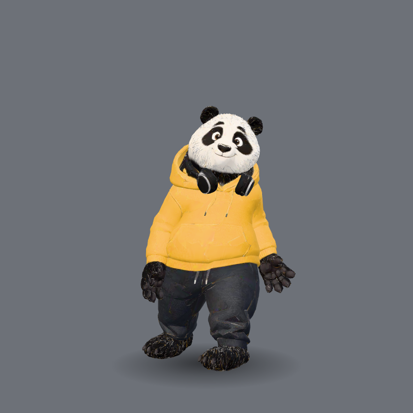
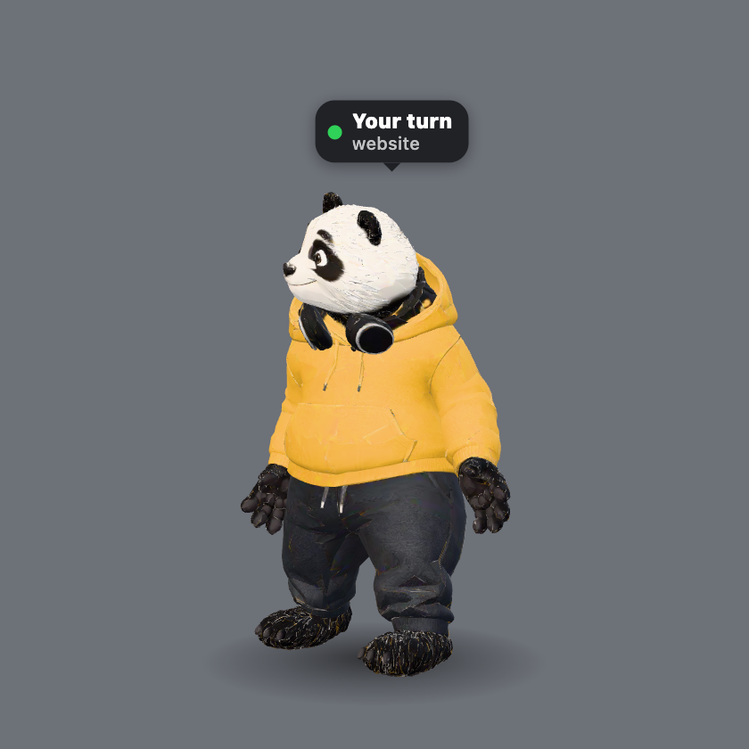
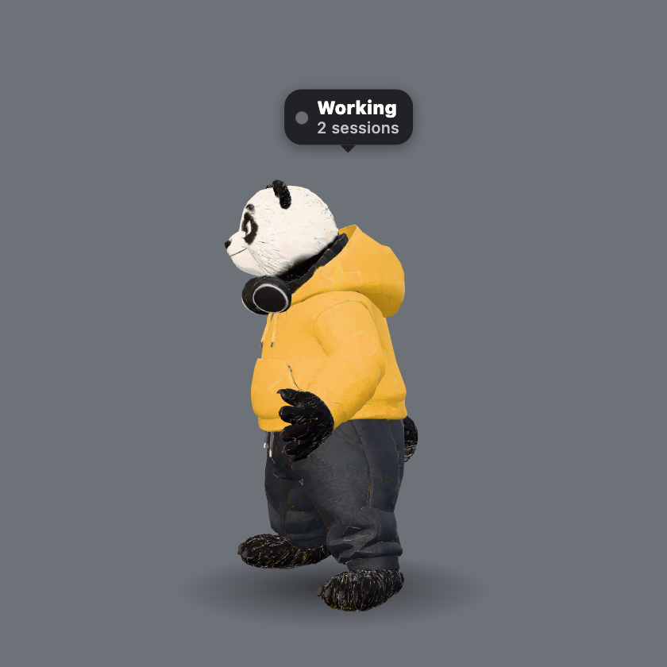

# Prompt Paws

A 3D panda that lives on your Mac's screen and tells you what Claude Code is doing. When a session needs
you, or it's your turn, its bubble says so, and one click on the panda brings you straight to that
session's Terminal tab, from Chrome or anywhere else.

**[⬇ Download Prompt Paws 1.0.0](https://github.com/biswajitdasb4-oss/prompt-paws/releases/latest/download/Prompt-Paws-1.0.0.zip)**
(macOS 13 or later, Apple Silicon or Intel, 2.9 MB) · [Install steps](#install)

<p align="center"></p>

## What it does

<p align="center">



</p>

| Bubble | Menu-bar icon | Means | Click the panda |
|---|---|---|---|
| 🟠 **Needs you** + project | orange hand | Claude asks for permission, asks you a question, or wants a plan approved | jumps to that session |
| 🟢 **Your turn** + project | green check | Claude finished and waits for your next prompt | jumps to that session |
| ⚪ **Working** + project | paw | Claude is thinking, editing, reading or running commands | waves, jumps, nods or dances |

- With several sessions the bubble says "2 sessions" and the paw menu lists each one. A click opens a
  session that needs you first, else the one whose turn has waited longest.
- The panda stays calm: it roams a little, sits, naps when you leave the Mac, and cheers when a session
  finishes. Three modes: Roam, Stay, Sleep.
- It floats above every app, on every desktop Space, and never takes keyboard focus. Clicks next to it go
  to the app below.

## Install

You need macOS 13 (Ventura) or later, on Apple Silicon or Intel, and
[Claude Code](https://code.claude.com).

### 1. Get the app

**Download (easiest)**
1. Download **[Prompt-Paws-1.0.0.zip](https://github.com/biswajitdasb4-oss/prompt-paws/releases/latest/download/Prompt-Paws-1.0.0.zip)**
   and open it. (On the [Releases](https://github.com/biswajitdasb4-oss/prompt-paws/releases/latest) page it
   is under **Assets**. Do not pick "Source code": that is not the app.)
2. Drag **Prompt Paws** into your **Applications** folder.
3. Open it. macOS says it can't check the app: click **Done**. Then open **System Settings › Privacy &
   Security**, scroll down, and click **Open Anyway** next to Prompt Paws (only the first time).

Why the warning? Apple only vouches for apps from paid developer accounts ($99 a year). Prompt Paws is a
free hobby project: it is signed, but not notarized by Apple. All the source is here. If you prefer,
build it yourself, which shows no warning.

**Build it yourself** (needs Apple's free Command Line Tools: `xcode-select --install`)
```
git clone https://github.com/biswajitdasb4-oss/prompt-paws.git
cd prompt-paws
./build.sh --install    # builds it and copies it to ~/Applications
```

### 2. Connect Claude Code

In Claude Code 2.1.275 or later:
```
/plugin install prompt-paws --marketplace biswajitdasb4-oss/prompt-paws
```
On older versions, two steps:
```
/plugin marketplace add biswajitdasb4-oss/prompt-paws
/plugin install prompt-paws@prompt-paws
```
Then start a new Claude Code session (or run `/reload-plugins`). Until the panda has seen a session, its
paw menu shows **Connect Claude Code…**, which opens this section.

### 3. The first click

The first time you click the panda while a session waits, macOS asks to let Prompt Paws control
Terminal. Click **Allow**: that is how it selects the right tab.

## Using it
- Start it from Spotlight (Command+Space, "Prompt Paws"). It has no Dock icon: look for the paw in the menu
  bar. Paw menu › **Start at Login** starts it every time you log in.
- **Modes** (paw menu, or right-click the panda; remembered with its spot):
  - **Roam Around**: strolls now and then, mostly rests, sits, looks around.
  - **Stay in One Place**: never walks; idles, sits, waves where it is.
  - **Sleep Here**: lies down and stays asleep until you click it.

  In Roam and Stay it also naps when you leave the Mac for 3 minutes, and wakes when you are back.
- **Drag** it anywhere. **Click** it while nothing waits: it waves, jumps, nods or dances.
- **Hide/show:** Option+Command+P (Finder uses the same keys for "Show Path Bar"; Prompt Paws takes them
  while it runs).
- More in the paw menu: Pause Animation (about 0% CPU), Size, Character, Open Log, Quit.

## Requirements and limits
- macOS 13 or later, Apple Silicon or Intel.
- The click selects the exact tab in Apple's **Terminal**. With other terminal apps (iTerm, VS Code,
  Ghostty and others) that app comes to the front, but the tab is not picked.

## Privacy
Everything stays on your Mac. The app makes no network requests (the **Connect Claude Code…** item only
opens this page in your browser). The plugin's hooks write one small file per Claude session in
`~/.promptpaws/sessions/`: its state, the time, the project folder's name and its Terminal tab. The app
reads these files and deletes them after a day.

## Uninstall
1. Paw menu: untick **Start at Login**, then **Quit Prompt Paws**.
2. Delete **Prompt Paws** from your Applications folder, or from `~/Applications` if you built it with `./build.sh --install`.
3. In Claude Code: `/plugin uninstall prompt-paws@prompt-paws`, then `/plugin marketplace remove prompt-paws`.
4. Delete the folder `~/.promptpaws`.

## How it works
- **The plugin** (`plugin/`) adds Claude Code hooks that run `plugin/hooks/pet-mood.sh <state>` (it prints
  nothing and always exits 0, so it never blocks Claude). The script writes
  `~/.promptpaws/sessions/<session id>` = `<state> <time> <project>`; for "needs you" and "your turn" a
  second line holds Claude's terminal and app (`ttys001 com.apple.Terminal`).

  | Hook | State |
  |---|---|
  | UserPromptSubmit | thinking |
  | PreToolUse: Edit/Write/MultiEdit/NotebookEdit, Read/Grep/Glob/Web*, Bash | typing, searching, working |
  | PreToolUse: AskUserQuestion/ExitPlanMode; PermissionRequest | needs you |
  | Notification | permission or question: needs you; idle: your turn |
  | PostToolUse | working (clears "needs you" after you answer) |
  | Stop, StopFailure | your turn |
  | SessionEnd | removes the session |

  A working session with no events for 20 minutes, or a waiting one older than 3 hours, stops counting
  (pressing Esc sends no hook event).
- **The app** (`Sources/`, Swift and AppKit): a see-through window on every Space (`PetWindow.swift`), what
  to do next, movement and Claude reactions (`Brain.swift`), the session files, hotkey, login item and
  characters (`Extras.swift`), menus and wiring (`App.swift`), and a self-test (`SelfTest.swift`).
- **The drawing** (`Resources/web/pet.js`, three.js 0.186): draws the character and plays its moves inside a
  WebKit view. Swift decides; JavaScript only draws.
- The click runs a short AppleScript that selects the Terminal tab by its tty.

## Build and checks
```
./build.sh               # "build/Prompt Paws.app" for this Mac's chip (no Xcode, no Node.js)
./build.sh --universal   # one app for Apple Silicon and Intel
./build.sh --zip         # universal build + build/Prompt-Paws-<version>.zip
./build.sh --install     # build, quit the running panda, copy to ~/Applications
"build/Prompt Paws.app/Contents/MacOS/PromptPaws" --selftest   # 39 checks: window, moves, Claude states, clicks, modes
tools/check-public.sh    # nothing private in the files about to be published
```
Tools that need Node.js (`npm install` first): `node tools/review.mjs <character>` renders turntable,
moves and bubbles to `build/review/`; `python3 tools/measure.py` measures real CPU per state.

Measured on a 2017 MacBook Pro (dual-core i5) under heavy load, % of one CPU core: about 7.5% while
roaming, 3.9% asleep, 0.4% paused or hidden. It renders at about 30 fps (10 asleep, 0 paused).

## How the panda was made
1. **Concept picture**: GPT Image 2.5, from an original prompt (`media/panda/prompts.md`; result
   `media/panda/concept.png`).
2. **3D model**: Meshy v7 image-to-3D, with texture, materials, a skeleton and an idle move
   (`media/panda/panda-meshy-ultra.glb`).
3. **11 more moves**: Meshy 3D rigging, one run per move (`media/panda/moves.md`).
4. **Finishing** (free, on the Mac): `tools/build-panda.sh` retargets every move onto one skeleton, puts
   each on the floor, fixes the shiny material, and compresses the texture
   (`Resources/characters/panda/model.glb`, 3.3 MB).

All paid steps ran through Higgsfield:

| Step | Model | Credits |
|---|---|---|
| Concept picture | GPT Image 2.5, high, 2K | 2.75 |
| 3D model | Meshy v7 image-to-3D, ultra | 53.5 |
| 11 moves | Meshy 3D rigging, 8 each | 88 |
| **Total** | | **144.25** |

Prompt Paws was designed by Biswajit Das and built with Claude Code as pair programmer, test-first, with
the self-test above.

## Your own character
A character is a folder with `character.json` and a rigged, animated model (`.glb`, `.gltf` or `.fbx`). Put
it in `~/.promptpaws/characters/<name>/` (paw menu › Character › Open Characters Folder); it shows in the
menu without a rebuild.
```json
{
  "name": "Robot",
  "credit": "who made it, licence",
  "model": "model.glb",
  "walkSpeed": 0.9, "runSpeed": 2.2,
  "facing": 0, "scale": 1, "yOffset": 0,
  "clips": { "idle": "Idle", "walk": "Walking", "sit": { "clip": "Sitting", "once": true } },
  "faces": { "dangle": { "Surprised": 1 } }
}
```
`walkSpeed` and `runSpeed` are body heights per second (match the feet, no sliding). `facing`, `scale` and
`yOffset` are optional fixes for a model that faces away or floats. Per clip you can also set `speed` and
`fade` (seconds, default 0.3). Behaviour keys: idle, walk, run, sit, sleep, wake, look, think, nod, no,
busy, wave, jump, dance, cheer, thumbs, dangle, land. Missing keys fall back (sleep to sit to idle).

## Credits and licenses
- Code: MIT License (`LICENSE`).
- The panda character, its model, moves and pictures: © 2026 Biswajit Das, CC BY-NC 4.0
  (`LICENSE-ART.md`). Made with GPT Image 2.5 and Meshy v7 through Higgsfield.
- Robot character: RobotExpressive by Tomás Laulhé (Quaternius), with changes by Don McCurdy, CC0
  (`Resources/characters/robot/LICENSE.md`).
- three.js (MIT), included in `Resources/web/vendor/three/`.

Prompt Paws is an independent project. It is not affiliated with or endorsed by Anthropic. Claude and
Claude Code are trademarks of Anthropic, PBC.
